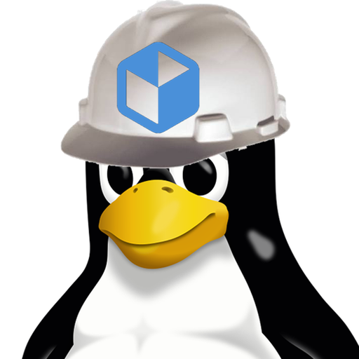
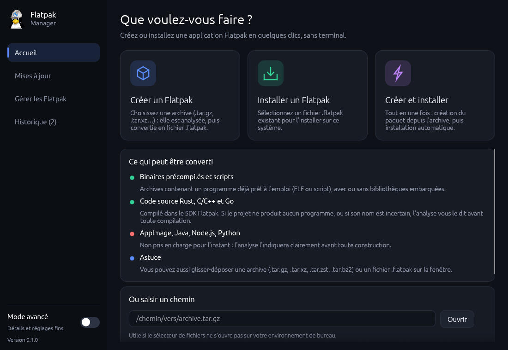

<div align="center">



# Flatpak Manager

**Créer, installer, mettre à jour et supprimer des Flatpak. Sans terminal.**

Logiciel libre pour Linux, écrit en Rust avec [egui](https://github.com/emilk/egui).

</div>

<p align="center">
  
</p>

## Pourquoi

Fabriquer son propre Flatpak demande d’écrire un manifeste, d’installer `flatpak-builder`, le bon runtime et le bon SDK, puis d’enchaîner les bonnes commandes. Flatpak Manager fait tout cela dans une fenêtre, à partir d’une simple archive.

## Fonctions

| | |
|---|---|
| **Créer** | Analyse une archive, génère le manifeste, construit avec `flatpak-builder` et exporte un `.flatpak`. |
| **Installer** | Vérifie puis installe un fichier `.flatpak` existant. |
| **Créer et installer** | Les deux enchaînés. |
| **Gérer** | Liste les applications (et runtimes) installés, désinstalle, retire les composants inutilisés. |
| **Mises à jour** | Recherche les mises à jour, met à jour un paquet ou tout en une fois. |
| **Ménage des SDK** | Retire les anciennes versions de SDK devenues inutiles, après confirmation. |

Aussi : sélecteur de fichiers natif, glisser-déposer, mode simple ou avancé, aperçu avant création, permissions réglables, diagnostic des erreurs, historique.

> **Sécurité.** Toute action destructive (désinstallation, ménage) affiche la commande exacte, un avertissement, et demande une confirmation explicite.

## Ce qui peut être converti

| Archive | État |
|---|---|
| Binaires précompilés et scripts (ELF ou script, avec ou sans bibliothèques) | Pris en charge |
| Code source Rust, C/C++ et Go | Pris en charge |
| Projets Python (`pyproject.toml`, `setup.py`, `requirements.txt` ou simple `main.py`) | Pris en charge : dépendances installées avec pip |
| Projets Node.js (`package.json`) | Pris en charge : dépendances installées avec npm, Node fourni par l’extension du SDK |
| Applications Java (`.jar` exécutable, avec `Main-Class`) | Pris en charge : JRE fourni par l’extension OpenJDK |
| Electron depuis les sources, Maven/Gradle, Ruby, PHP, Zig, Elixir, AppImage | Pas encore : l’analyse l’indique avant toute construction |

Formats d’archive : `.tar.gz`, `.tar.xz`, `.tar.zst`, `.tar.bz2`.

### Vérifications avant extraction

Format détecté par les premiers octets, chemins absolus ou contenant `..`, liens symboliques sortant de l’archive, écriture à travers un lien, fichiers spéciaux, bombes de décompression, architecture du binaire (x86_64 et aarch64 ; 32 bits refusé).

### Code source

Le projet est reconnu par ses fichiers de build : `Cargo.toml`, `CMakeLists.txt`, `meson.build`, `configure.ac`/`Makefile.am`, `Makefile`, `go.mod`. Il est compilé dans le bac à sable de `flatpak-builder` avec le SDK Freedesktop, dans la version la plus récente disponible. Un projet sans programme à compiler, ou dont le nom du binaire est incertain, est signalé avant toute compilation.

La carte « Environnement de compilation » liste les composants requis, affiche la commande exacte pour installer ceux qui manquent (par exemple `flatpak install --user -y flathub org.freedesktop.Sdk.Extension.rust-stable//25.08`) et bloque la création tant qu’ils manquent.

**Limites actuelles :** les dépendances (crates, modules Go, paquets pip et npm) sont téléchargées pendant la création, le paquet n’est donc pas publiable tel quel sur Flathub. Les extensions Node.js et OpenJDK existent en plusieurs versions : l’application choisit celle déjà installée, sinon la plus récente disponible. Le support Python, Node.js et Java est récent et n’a pas encore été éprouvé sur un vrai build Flathub.

## Installation

### Compiler

```bash
cargo build --release --locked
./target/release/flatpak-manager
```

Prérequis : `flatpak` (le paquet `flatpak-builder` est installé via Flathub s’il manque) et un `xdg-desktop-portal` pour le sélecteur de fichiers.

### AppImage

```bash
packaging/build-appimage.sh
```

Produit `dist/Flatpak_Manager-<version>-<arch>.AppImage` (télécharge `appimagetool` si absent). Compilez sur une distribution plutôt ancienne pour une meilleure compatibilité avec la glibc. L’AppImage utilise le `flatpak` et le `flatpak-builder` de la machine.

### Intégration au bureau

- `packaging/flatpak-manager.desktop` → `~/.local/share/applications/`
- `packaging/flatpak-manager-servicemenu.desktop` → `~/.local/share/kio/servicemenus/` (menu contextuel de Dolphin, `chmod +x` requis)

## Compatibilité

- **KDE et GNOME :** sélecteur via `xdg-desktop-portal`. Sans portail, repli sur `zenity` ou `kdialog`, et un champ permet de coller un chemin.
- **Wayland uniquement :** l’application est compilée sans X11 et refuse de démarrer hors d’une session Wayland. La bibliothèque de fenêtres (winit 0.30) ne gère pas encore le glisser-déposer en Wayland natif : utilisez « Parcourir », « Ouvrir avec » ou le champ de chemin.
- **Dans un Flatpak :** l’application passe par `flatpak-spawn --host`, ce qui demande une permission (voir [Permissions et sécurité](#permissions-et-sécurité)).

## Permissions et sécurité

Flatpak Manager lance `flatpak` et `flatpak-builder` sur votre machine. Voici ce qu'il fait et ce qu'il demande.

**Lancé directement (hors Flatpak).** Aucune permission particulière : l'application s'exécute avec vos droits d'utilisateur. Elle n'a pas besoin de `root`. Les installations se font par défaut en mode utilisateur (`--user`) ; l'installation pour tout le système est une option, et c'est alors `flatpak` qui demande l'autorisation.

**Dans un Flatpak.** L'application doit appeler l'hôte avec `flatpak-spawn --host`, ce qui demande la permission D-Bus `org.freedesktop.Flatpak`. Cette permission donne le droit d'exécuter des commandes en dehors du bac à sable : elle équivaut à un accès complet à votre session. Elle n'est donc jamais accordée automatiquement. Si elle manque, l'application affiche la commande à copier :

```bash
flatpak override --user --talk-name=org.freedesktop.Flatpak <identifiant>
```

Elle a aussi besoin de `--socket=wayland` pour s'afficher et, pour lire vos archives, d'un accès aux fichiers (le portail de sélection de fichiers suffit).

**Commandes exécutées.** Uniquement `flatpak` (`install`, `uninstall`, `update`, `list`, `info`, `remote-add`, `remote-ls`, `build-bundle`, `run`), `flatpak-builder` et `xdg-open` (pour ouvrir un dossier). Les actions destructives affichent la commande exacte avant d'agir.

**Fichiers écrits.** `~/.config/flatpak-manager/` (paramètres), `~/.local/share/flatpak-manager/` (historique), `~/.cache/flatpak-manager/` (dossier de travail temporaire et journal de démarrage), plus le `.flatpak` que vous demandez.

**Réseau.** L'application elle-même n'envoie aucune donnée. Le réseau est utilisé par `flatpak` (Flathub : runtimes, SDK, mises à jour) et, pour les projets de sources, pendant la construction (téléchargement des dépendances).

**Archives.** Elles sont contrôlées avant tout traitement (voir « Vérifications avant extraction »). Une archive provenant d'une source inconnue reste du code exécuté sur votre machine : ne créez un Flatpak que depuis des archives de confiance.

**Permissions des applications créées.** Elles sont choisies à l'écran de revue (affichage, GPU, audio, réseau, accès aux fichiers, périphériques…) et un avertissement s'affiche pour les choix larges comme « Tout le dossier personnel » ou « Tous les périphériques ».

## Développement

Voir [ARCHITECTURE.md](ARCHITECTURE.md) pour le rôle de chaque module et [CONTRIBUTING.md](CONTRIBUTING.md) pour contribuer.

```bash
cargo fmt --check
cargo clippy --all-targets --locked -- -D warnings
cargo test --locked
```

La CI GitHub Actions lance ces trois commandes à chaque *push* et *pull request*. La version de Rust est fixée dans `rust-toolchain.toml` et les dépendances dans `Cargo.lock`, qui est versionné.

## Licence

Flatpak Manager est un logiciel libre distribué sous licence [GNU GPL v3](LICENSE) ou ultérieure.
